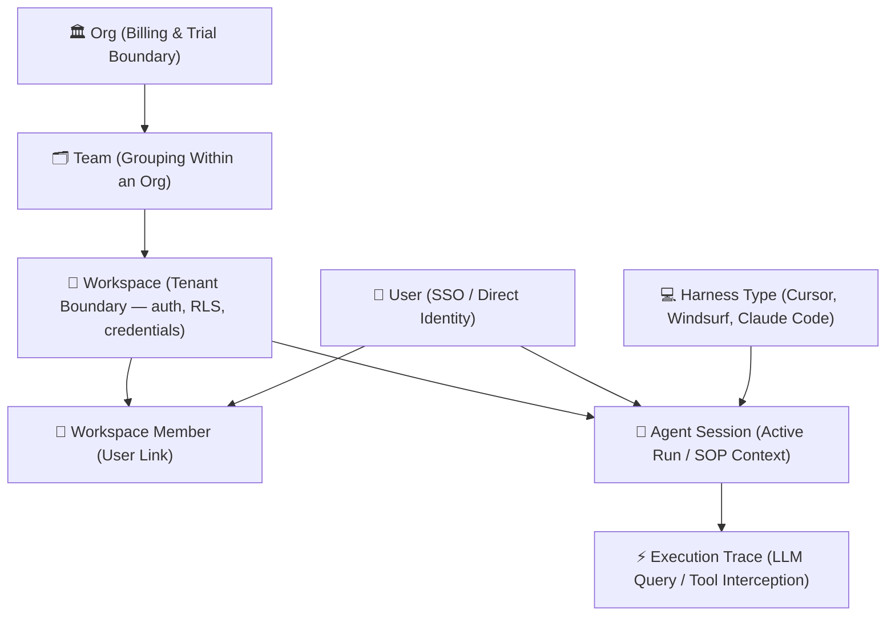

# Entity Hierarchy & Workspace Resolution <Badge type="tip" text="Cloud" />

This page documents how the Intutic Proxy resolves the target workspace for incoming requests and the logical model hierarchy connecting organizations, developers, and agent execution logs.

---

## 1. Workspace Resolution Logic

Since the Intutic Proxy is a multi-tenant gateway, it must identify which workspace owns each intercepted LLM query in order to retrieve the correct rules, budgets, and DLP policies. 

When a request hits the Rust proxy gateway, it resolves the `workspace_id` using the following sequence:

```
                  Incoming LLM Interception Request
                                │
                                ▼
          Does the virtual key name a workspace?
               (vk_{32 hex}_{workspace_id})
                              /     \
                            YES      NO
                            /         \
                           ▼           ▼
           workspace_id from key    "x-workspace-id" header,
           (403 if the header       else INTUTIC_WORKSPACE_ID
            names another)
                            \         /
                             ▼       ▼
             Authenticate the key: its record's workspace wins
             (403 workspace_mismatch if the request claimed another)
```

### A. HTTP Header Inspection
The proxy reads an explicit `x-workspace-id` HTTP header, set by the harness on session start. It decides the workspace only when the key itself names none (an attenuated child key, or a provider key on a standalone proxy); when both name a workspace and they differ, the request is refused with `403 workspace_mismatch`. With neither, the proxy falls back to its `INTUTIC_WORKSPACE_ID` environment variable.

### B. Virtual Key Parsing
Intutic virtual keys minted by the control plane follow a structured format:
`vk_{32 hex characters}_{workspace_id}` (older keys: `vk_{ws_…}_{32 characters}`)

The proxy reads the `workspace_id` suffix, then authenticates the key (the Valkey cache first, the control plane on a miss). The authenticated key record is the authority: the proxy adopts its workspace and refuses a request that claimed a different one with `403 workspace_mismatch`, then retrieves that tenant's policy settings.

---

## 2. Platform Entity Hierarchy

Intutic organizes accounts, user identities, development harnesses, and agent runs in a relational hierarchy. An **org** sits above the workspace, owning billing and team structure; a **personal** signup gets an implicit org of its own so every workspace — including the very first one a solo developer creates — has the same non-nullable `org_id`/`team_id` ancestry, with no special-cased "no org" branch anywhere downstream.



### 🏛️ Org
* **Purpose**: The billing and trial boundary. `kind: 'personal'` is the implicit org every individual signup gets — capped at exactly one team and one workspace: a second team is refused, and so is a second workspace (`POST /api/v1/teams/:teamId/workspaces` answers 403 `personal_workspace_limit`), so a single user can never create more than their one default workspace. `kind: 'org'` is a real organization (`POST /api/v1/orgs`, from an already-authenticated caller, gated behind DNS domain-ownership verification since it auto-provisions a real managed gateway cell — see [Organizations, Teams & Billing](/guide/organizations)), on a paid tier with a 30-day trial from creation, capable of creating additional teams up to its plan's `maxTeamsPerOrg` limit.
* **Table**: `orgs` — `orgId`, `kind`, `planTier`, `trialExpiresAt`, `dailySpendCapUsd`, `monthlyBudgetUsd`, `stripeCustomerId`, `stripeSubscriptionId`, `ownerUserId`, `gatewayId` (nullable — see [Self-Hosted Gateway](/external/self-hosted-gateway)).
* **Authority**: `orgs.ownerUserId` is reserved for the one single-owner fact (billing/deletion authority), but neither org-creation path populates it yet (both write `null` pending the users backfill), so nothing reads it. "Can manage this org's teams and workspaces" is derived, not a separate role: any user holding `OWNER`/`ADMIN` on *any* active workspace under the org counts (`hasOrgAdminAccess`) — there is no parallel Org-Owner/Org-Admin role split, since `WorkspaceRole`'s `OWNER`/`ADMIN` already converge everywhere a split would add.

### 🗂️ Team
* **Purpose**: Groups workspaces under an org. A personal org's one team is created automatically at signup and cannot be added to; a real org's default team is created at org creation, and admins can create more (`POST /api/v1/orgs/:orgId/teams`) up to the plan's team limit.
* **Table**: `teams` — `teamId`, `orgId` (FK, cascade), `name`, `slug`.

### 🏢 Workspace
* **Purpose**: The primary security and isolation boundary — unchanged by the org/team layer above it. All budgets, DLP configurations, WASM rules, provider credentials, and Postgres RLS policies are still keyed on `workspace_id` alone; org/team is an ancestor, not a re-scoping. Every workspace's `orgId`/`teamId` are non-nullable (denormalized onto `workspaces` so hot-path billing/auth checks need no extra join).
* **Table**: `workspaces` — gains `teamId`, `orgId`, `gatewayId` (nullable per-workspace gateway override, set with `PATCH /api/v1/workspace/gateway`; it wins over the org's default — see [Self-Hosted Gateway §3](/external/self-hosted-gateway#pointing-a-workspace-at-your-gateway)).
* **Creation**: `POST /api/v1/teams/:teamId/workspaces` — the calling admin is added as the new workspace's `OWNER` (a JWT is workspace-scoped, so being an org admin elsewhere grants no automatic session on a newly created workspace). A new workspace inherits its org's current `planTier`/`dailySpendCapUsd`/`monthlyBudgetUsd` at creation time; a later org-plan change write-through updates every workspace under the org to match.

### 👤 User & Workspace Member
* **Purpose**: The developer's physical identity — provisioned directly by an admin, or created on first SSO login (SAML 2.0 or OIDC). Users are mapped to one or more workspaces with specific roles (`OWNER`, `ADMIN`, `EM`, `DEVELOPER`, `VIEWER`) via the membership link. One person can hold membership in workspaces under different orgs simultaneously — a personal signup that later joins or creates a real org keeps their original personal workspace untouched; a new `workspace_members` row under the new org links to the same `users.userId`.
* **Table**: `users` + `workspace_members`

### 💻 Harness Type
* **Purpose**: The specific client environment executing the agent (e.g., Cursor, Windsurf, Claude Code CLI, Antigravity). This is tagged on sessions to customize routing or apply harness-specific rules.

### 🤖 Agent Session
* **Purpose**: Represents an active, contiguous run of an agent session spawned by a user inside a workspace. It links to the active standard operating procedure (SOP) being enforced and isolates the budget for that run.
* **Table (Enterprise Control Plane)**: `agent_sessions`

### ⚡ Execution Trace (Leaves)
* **Purpose**: The individual actions, tool invocations, or LLM chat completions occurring within a session. The Rust proxy intercepts and evaluates rules at this level.
* **Table (Enterprise Control Plane)**: `execution_traces`

---

## 3. Multi-Developer Environments & Sync Daemon Isolation

In enterprise environments with multiple developers, Intutic maintains isolated live monitoring and centralized compliance audits through two distinct layers:

### A. Heartbeat and Telemetry Isolation
* The sync daemon heartbeat is cached in Valkey per workspace (`v2:sync:heartbeat:${workspaceId}`, 120-second TTL). It holds the most recent daemon report for that workspace, not one entry per developer.
* There are no developer sub-workspaces. The isolation unit is the workspace: an org admin can create more workspaces under the org (`POST /api/v1/teams/:teamId/workspaces`), and each keeps its own SOPs, DLP configuration and WASM rules.
* What every workspace under an org shares is the org-level SOP floor: an org admin publishes SOPs with `POST /api/v1/workspace/org-sops`, and each workspace enforces them in addition to (never instead of) its own.

### B. Centralized Audit Aggregation
* When developers run AI agent sessions (e.g., Cursor, Claude Code, Aider), the Rust proxy gateway intercepts the execution traces.
* Every trace belongs to an agent session, and the session records **both** the developer's identity (`user_id`) and the `workspace_id`; incident records carry the `workspace_id` and the session.
* This allows security teams, managers, and SREs to view and search consolidated logs, compliance scores, and compute budgets across the entire team in the **Traces** (`/activity/traces`), **Review Queue** (`/findings/review`), and **Compliance Scope** (`/policies/scope`) views without any conflict.
