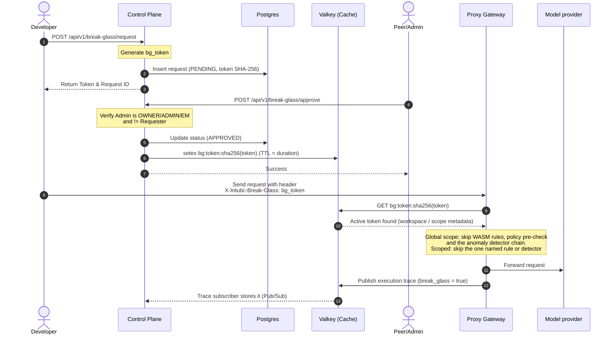

# Emergency Overrides <Badge type="tip" text="Cloud" />

Temporarily bypass safety policies and custom WASM rules in emergency situations.

---

## Overview

In production environments, there are times when an agent needs to perform an action blocked by existing Standard Operating Procedures (SOPs) or security policies for urgent debugging, hotfixes, or diagnostics.

The emergency override workflow (also called break-glass) provides an audited, time-limited bypass mechanism that maintains high security by requiring peer double-authorization.

---

## How It Works



---

## Requesting and Approving Overrides

### 1. Submitting a Request
Open **Policies › Emergency Overrides** (`/policies/overrides`; Owners, Admins and Engineering Managers) and use the **Request an override** card:
1. Enter the **Scope (optional)** to bypass, or leave it empty for a global bypass. A scope is `wasm:<ruleId>` (one custom WASM rule) or `detector:<detectorId>` (one anomaly detector); nothing else can be named. SOPs and hook rules have no bypass, and DLP, the workspace hard-cap block and `deny_tools` are never skipped by any token. Only a global bypass skips the control plane's pre-check (key validity, the workspace budget cap, loop status and plan limits); a scoped token never does.
2. Choose the **Duration**: 15 minutes, 30 minutes, 1 hour, 4 hours, 8 hours or 24 hours.
3. Click **Request override**.
4. Under **Copy your bypass token now**, click **Copy** next to the **Bypass token**. *It is shown only this once — the control plane does not display it again after this step, and it is not at rest anywhere: the request row and the cache key the approval writes hold only its SHA-256.* Treat it as a live credential for the whole bypass duration: anyone holding it can use it until it expires.

### 2. Peer Approval (Double Authorization)
To prevent security gaps:
- Nobody **can approve their own override request**.
- Approving needs the OWNER, ADMIN or EM role (`POST /api/v1/break-glass/approve` refuses any other role with `403`), so another owner, administrator or engineering manager clicks **Approve** on the request in the **Override requests** card on the same page, which lists each request's requester, status, scope, duration, expiry and approver.
- Once approved, the control plane activates the token and writes its SHA-256 to the Valkey cache, where it expires after the approved duration.

---

## Using the Override Token

Once the token is approved, include it as an HTTP header in requests routed through the Intutic Proxy Gateway:

```http
X-Intutic-Break-Glass: bg_xxxxxxx
```

For the configured duration, the proxy will:
1. Validate the token (a single cache GET keyed on the token's SHA-256, scoped to the workspace the approval named).
2. Mark the request's execution trace `break_glass = true` with the approval's request id, and log the bypass with that request id.
3. Skip what the approval's scope allows:
   - **Global** (no scope): the custom WASM rules, the control plane's policy pre-check, and the whole anomaly detector chain — none of the twelve detector categories run, so no finding is recorded under any category.
   - **`wasm:<ruleId>`**: that one WASM rule is not evaluated. Every other rule, every detector and the pre-check still run and can still block.
   - **`detector:<detectorId>`**: that detector's findings are dropped. Every other detector, every WASM rule and the pre-check still run; the corroboration count reflects the detectors that still apply.

A scoped token narrows a bypass; it never widens one. Scopes written before validation existed (an unprefixed id) are read as `wasm:<id>`.

---

## Revocation

When the member who requested an override is offboarded through [SCIM](/guide/scim#offboarding-cascade), their requests in that workspace are revoked: a pending request can no longer be approved (`POST /api/v1/break-glass/approve` answers `400`), and an approved token's cache entry is deleted, so the proxy stops honouring it on the next request rather than when it expires. The request shows as `REVOKED` in **Override requests**, with the time and the reason (`offboarding`) recorded on it.

---

## Security and Compliance Auditing

All break-glass activities are logged persistently:
- **Request logs:** Track who requested the override, its scope, and the requested duration.
- **Approval logs:** Track who approved the bypass.
- **Execution logs:** every request served under a break-glass token is recorded on its execution trace as `break_glass = true` with the approval's request id (`break_glass_request_id`), so the traces a token covered can be listed after the fact. The token itself is never written to a trace or a log; the proxy logs the request id on success and a short hash of the token on a denial.

::: warning
Bypassing compliance rules presents significant security risks. Break-glass tokens should only be used as a last resort in active incidents and must be reviewed immediately after expiration.
:::

---

## Related
- [Security & Identity](/guide/security) — SSO, API Keys, and RBAC roles
- [Settings & Configuration](/guide/settings) — Configuring control plane parameters
